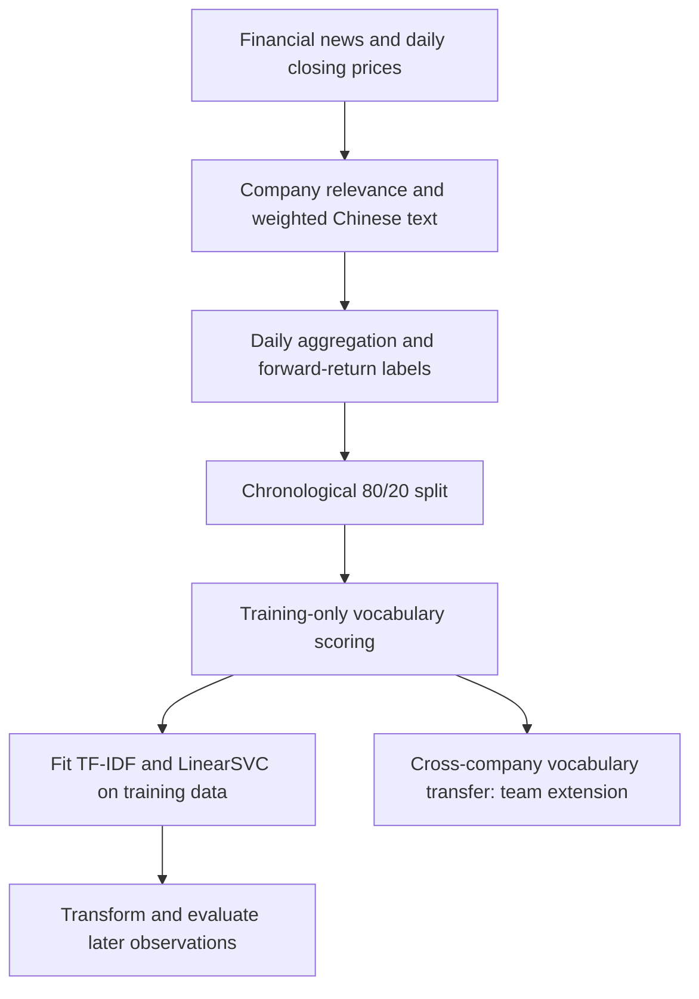
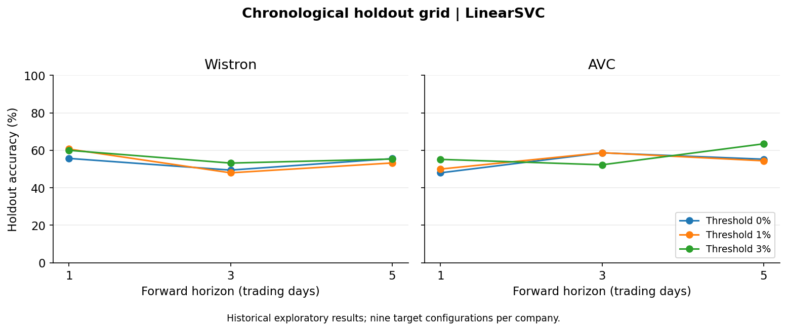
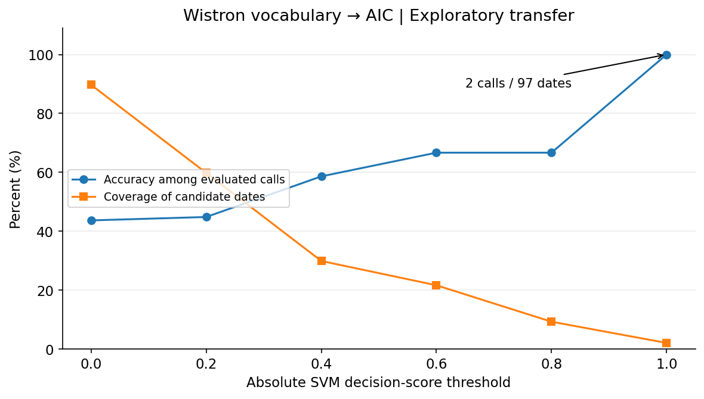

# Cross-Company News-Based Stock Movement Prediction

**Financial NLP · Statistical feature selection · Temporal model validation · Cross-company signal transfer**

A six-person team project for the Big Data and Business Analytics course at National Taiwan University.

## Overview

Financial news coverage differs substantially across firms in the same supply chain. We investigated whether discriminative textual signals learned from larger firms could complement stock movement prediction for smaller firms with less news coverage. The study examined Wistron (3231) and Asia Vital Components (AVC, 3017), with extensions to AIC (3693) and Jentech (3653).

This portfolio emphasizes the Chinese-language news pipeline and my independently developed training-only feature selection workflow for Wistron and AVC. Cross-company transfer is presented as a team-level extension.

## My Contributions

- Co-designed the research framework and company selection for investigating cross-company financial news signals.
- Co-developed Chinese news preprocessing, including company relevance filtering, MONPA tokenization, jieba part-of-speech filtering, and title-and-lead weighting.
- Co-developed statistical vocabulary scoring using chi-square, mutual information, document-rate measures, and TF-IDF, and conducted experiments on text scope, prediction horizons, and return thresholds.
- Independently identified feature selection leakage and redesigned the evaluation pipeline to construct discriminative vocabularies and fit TF-IDF exclusively on chronological training data.
- Participated in interpreting rolling backtests, prediction coverage, and cross-company vocabulary transfer.

My primary contributions focused on NLP feature engineering, statistical feature selection, and evaluation methodology. SQL data extraction and the broader five-classifier comparison were handled by other team members. Cross-company backtesting and its results are team-level work.

## Data and Analytical Workflow

The original course database combined historical stock prices, company metadata, and financial news. We retained articles from Yahoo News and Yahoo Stock and constructed company-specific daily text representations.

| Company | Daily text records | Sum of article counts | Text date range |
|---|---:|---:|---|
| Wistron (3231) | 632 | 5,078 | 2023-03-02 – 2025-02-28 |
| AVC (3017) | 450 | 1,381 | 2023-03-08 – 2025-02-26 |
| Total | **1,082** | **6,459** | |

Counts describe the archived daily text files before matching trading dates and return labels. See [corpus summary](results/corpus_summary.csv).



## Financial NLP and Feature Engineering

The pipeline identifies articles in which the company is central, emphasizes titles and the first 180 characters of the article, filters company-specific signals, and applies MONPA segmentation and jieba part-of-speech filtering. Weighted text and segmented tokens are aggregated by publication date. Text scope experiments compare title-and-lead representations with versions that also incorporate the full article.

The refined vocabulary score combines class-specific min-max normalized measures:

| Component | Weight |
|---|---:|
| Chi-square | 35% |
| Mutual information | 25% |
| Class-specific document rate | 20% |
| Class-specific mean TF-IDF | 10% |
| Directional prevalence ratio | 10% |

Terms must occur in at least three training documents and exhibit at least a twofold directional prevalence ratio. Blacklists remove generic noise and non-target company names. Up to 200 terms per class are selected and combined into a discriminative vocabulary. See [NLP methodology](docs/nlp_methodology.md) and [core implementation](src/temporal_grid.py).

## Temporal Model Validation

For each horizon (1, 3, or 5 trading days) and return threshold (0%, 1%, or 3%), closing-price returns define up/down labels; neutral observations are excluded. I independently restructured the feature selection process so that the vocabulary is learned only from the earlier 80% of eligible dates, with TF-IDF fitted on the same training partition. Later dates are transformed using the fitted vocabulary and vectorizer and evaluated with LinearSVC.



| Company | Horizon | Return threshold | Training dates | Holdout dates | Accuracy | F1 (up) |
|---|---:|---:|---:|---:|---:|---:|
| Wistron | 1 day | 1% | 244 | 61 | 60.66% | 0.6471 |
| AVC | 5 days | 3% | 205 | 52 | 63.46% | 0.6885 |

The table shows the highest-accuracy configurations among the nine archived holdout experiments per company. All configurations are retained in [temporal grid results](results/temporal_grid_results.csv). These are exploratory holdout comparisons, not independently selected final-test estimates; see [evaluation protocol](docs/evaluation.md).

## Cross-Company Signal Transfer

As a team extension, we examined whether a vocabulary learned from a larger firm could represent news about a smaller firm. The Wistron-to-AIC case uses a fixed Wistron vocabulary, fits a target-company LinearSVC over a rolling 60-observation window, and varies the absolute SVM decision-score threshold to assess the accuracy–coverage trade-off.



| Decision-score threshold | Evaluated calls | Coverage | Accuracy among evaluated calls |
|---|---:|---:|---:|
| 0.0 | 87 / 97 | 89.69% | 43.68% |
| 0.4 | 29 / 97 | 29.90% | 58.62% |
| 0.6 | 21 / 97 | 21.65% | 66.67% |
| 1.0 | 2 / 97 | 2.06% | 100.00% |

The highest threshold leaves only two evaluated calls. This illustrates why accuracy alone is insufficient when evaluating selective predictions. See [all thresholds](results/transfer_threshold_results.csv) and [cross-company methodology](docs/cross_company_transfer.md).

## Key Findings and Business Implications

- **Text relevance matters.** Company-specific filtering and weighted text representations aim to isolate relevant industry and firm signals from generic market news.
- **Validation design matters as much as model selection.** Supervised vocabulary construction must be restricted to training observations to avoid incorporating test labels into the feature space.
- **Prediction targets influence evaluation.** Different return thresholds and horizons change the number of eligible observations and the definition of a correct prediction; performance should be interpreted alongside sample size.
- **Cross-company transfer involves an accuracy–coverage trade-off.** Sparse predictions can produce high conditional accuracy without providing broad decision support. Both measures are needed to evaluate the usefulness of a selective prediction system.

The study demonstrates an interpretable financial-text workflow for investigating market signals and assessing prediction reliability, rather than a claim of investment profitability.

## Repository Guide

| File | Purpose |
|---|---|
| [News preprocessing](src/preprocess.py) | Relevance filtering, text weighting, segmentation, daily aggregation |
| [Domain dictionaries](src/domain_terms.py) | Company-specific financial and industry terms |
| [Temporal grid](src/temporal_grid.py) | Forward-return labels, training-only vocabulary scoring, TF-IDF, LinearSVC |
| [Transfer backtest](src/transfer_backtest.py) | Fixed vocabulary and rolling target-company classifier |
| [Text scope counts](results/text_scope_counts.csv) | Historical aggregate counts from the text representation comparison |
| [Data requirements](data/README.md) | Input schemas and local data preparation |

## Running the Analysis

Install the core dependencies and run the synthetic unit tests:

```bash
python -m pip install -r requirements.txt
python -m unittest discover -s tests -v
```

With authorized local data prepared as described in [data requirements](data/README.md), run:

```bash
python src/temporal_grid.py --stock 3231 --prices data/local/prices.csv --daily-text data/local/daily_3231.csv --companies data/local/companies.csv --output outputs/wistron
```

Use `--stock 3017` with the corresponding daily file for AVC. Raw course data are kept local. The aggregate results and figures are reconstructed from saved course outputs, not a new model fit.
